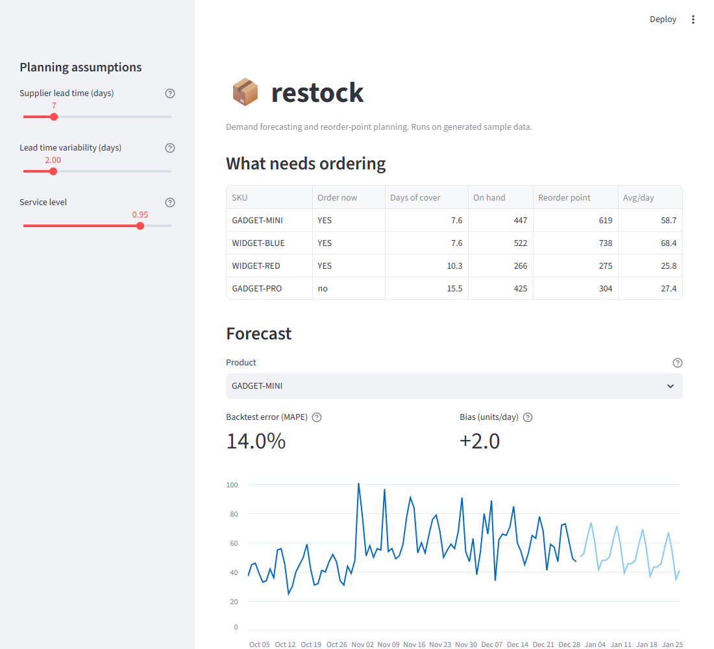

# restock

Demand forecasting and reorder-point planning for inventory teams.

Tells you which products are about to stock out, how much buffer to hold against a supplier
who runs late, and when to place the order.



## Why I built it

I spent seven years running inventory for a warehouse shipping over 500,000 units a year.
The two questions that actually matter on that floor are "what do I order" and "how much
cover do I hold", and most teams answer both with a spreadsheet and a guess.

This is those two questions written out properly: a forecast that understands weekly and
seasonal patterns, and a buffer sized against how much demand AND the supplier vary.

## Quickstart

```bash
pip install -e ".[dev,dashboard]"
restock demo
```

That generates two years of sample sales and plans against it. No data of your own needed.

```
REORDER PLAN  -  lead time 7 days, service level 95%
======================================================================================
SKU                Avg/day   Next 7d    Safety   Reorder pt     MAPE    Naive     Bias
--------------------------------------------------------------------------------------
GADGET-MINI           58.7       390        77          488    14.0%    20.4%      2.0
WIDGET-BLUE           68.4       899       129          607    27.3%    30.5%     19.5
```

Against your own history:

```bash
restock plan --input sales.csv --lead-time 10 --lead-time-sd 3
```

The CSV needs three columns: `date`, `sku`, `units`. There is a sample in
[`data/sample_sales.csv`](data/sample_sales.csv).

The dashboard in the screenshot:

```bash
streamlit run app.py
```

## How it works

### Forecasting: Holt-Winters

Retail demand has three things going on at once. A slow drift up or down, a repeating
weekly shape (Saturdays are not Tuesdays), and noise. Holt-Winters tracks all three
separately and updates each as new sales arrive:

```
level_t    = alpha * (demand_t - season_t-m) + (1 - alpha) * (level_t-1 + trend_t-1)
trend_t    = beta  * (level_t - level_t-1)   + (1 - beta)  * trend_t-1
season_t   = gamma * (demand_t - level_t)    + (1 - gamma) * season_t-m

forecast_t+h = level_t + h * trend_t + season_t+h-m
```

Each smoothing factor is how fast that component reacts. Higher reacts quicker and is
noisier.

It is written out in [`forecast.py`](src/restock/forecast.py) rather than imported from
`statsmodels`. In production you should usually use the library. Here the method is the
point.

### Safety stock: buffer the supplier too

```
safety stock  = z * sqrt( lead_time * demand_sd^2  +  demand_mean^2 * lead_time_sd^2 )
                          \___ demand varies ___/     \___ supplier varies ___/

reorder point = demand_mean * lead_time + safety stock
```

The second term under the square root is the one teams leave out, and it is usually the
bigger of the two. In the test case in
[`test_policy.py`](tests/test_policy.py), a supplier whose lead time swings by two days
contributes ten times more buffer than the demand variation does. Buffer demand alone and
you under-stock by 245 units while believing you are at a 95% service level.

`z` comes from the service level, which is a business decision about how often you are
willing to stock out. It is a required argument, not a default, because 95% is a choice
somebody should make on purpose.

### Measuring whether it works

Every forecast is scored against a **naive seven-day average** on weeks the model never
saw. A model that cannot beat a flat average is not earning its keep, and that comparison
is in the CLI output so you can check it rather than take my word.

It also reports **bias** alongside error, because a forecast can look respectable on
average error and still run low every single week, which quietly starves the warehouse.

## How the maths is verified

There is no published worked example bundled here. The models are checked against
constructed series where the correct answer follows from the arithmetic:

- a clean repeating cycle must be reproduced
- a pure linear trend must initialise with seasonal offsets of exactly zero
- the initialisation step is checked term by term against numbers worked out on paper
- safety stock and reorder point are checked against hand calculations, including the
  edge cases

That pins the behaviour across the whole method rather than at one point in one table.

**The bug this caught.** Adding the naive baseline showed Holt-Winters losing to a flat
average on three of four products. The forecast was restarting the seasonal cycle at index
zero instead of continuing from where the fit ended, so a model trained on 730 days of
weekly data was forecasting day 731 with Monday's shape. The whole weekly pattern was
shifted by two days.

Every seasonal test passed, because each used a series whose length was an exact multiple
of the season, where starting at zero is accidentally correct. There is now a regression
test that ends mid-cycle. One product's seven-day error went from 27.3% to 10.5%.

## What this is not

- **Not a replacement for a planning system.** No multi-echelon, no supplier constraints,
  no purchase orders, no ERP integration.
- **Not using multiplicative seasonality.** The additive form here suits demand that swings
  by roughly the same number of units each cycle. Demand that swings by a percentage wants
  the multiplicative form.
- **Not auto-tuned.** The smoothing factors are sensible defaults, not fitted ones.
- **Not accurate day by day, and it should not be.** A daily forecast for noisy retail
  demand is routinely 20 to 30% off. That is not a broken model. It is the reason safety
  stock exists.
- **The stock levels in the dashboard are made up.** A real deployment reads them from an
  ERP.

## Running the checks

```bash
pytest                      # 70 tests
ruff check .                # lint
ruff format --check .       # formatting
mypy                        # strict type checking
```

All four run on every push via [GitHub Actions](.github/workflows/ci.yml), on Python 3.11
and 3.12.

## Built with

Python 3.11+, numpy, pandas, Streamlit. No forecasting library.

## Licence

MIT. See [LICENSE](LICENSE).

---

**Isaiah Soto** · [Izzysoto199806@gmail.com](mailto:Izzysoto199806@gmail.com) ·
[github.com/isoto002](https://github.com/isoto002)
